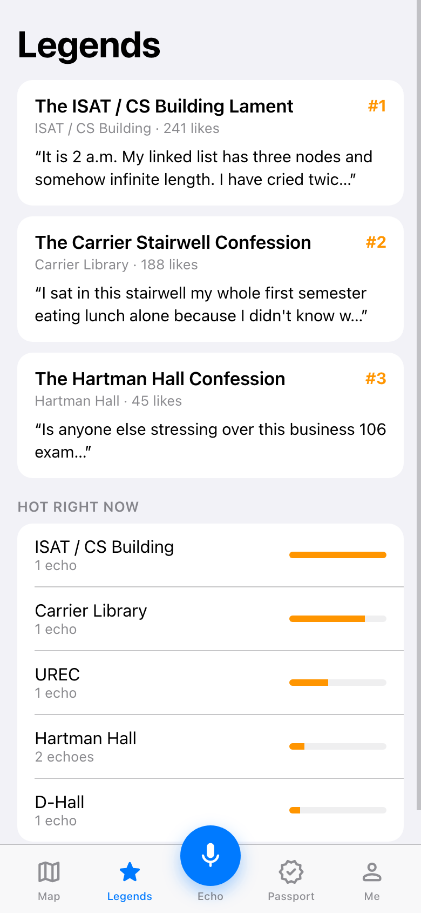
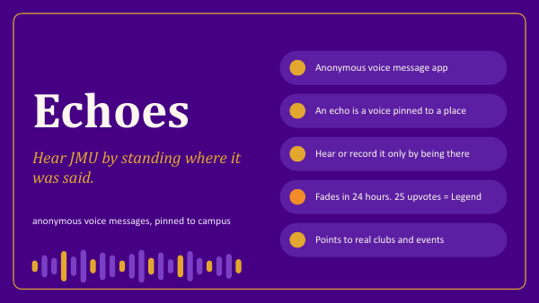
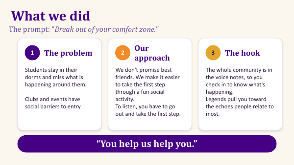
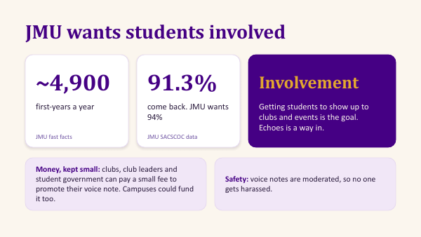

<h1 align="center">Echoes</h1>
<p align="center"><b>Hear JMU by standing where it was said.</b></p>
<p align="center">Anonymous voice notes pinned to real places on campus. You can only hear one by being there.</p>

<p align="center">
  🥉 <b>3rd place, JMU Makeathon 2026</b> · built in 24 hours, November 13 to 14
</p>

<p align="center">
  
  
  
  
  
  
</p>

<p align="center">
  
  
  
  
</p>
<p align="center"><sub>Map, record, Legends, Passport. The top two Legends and their like counts are seeded examples; the third was recorded in the demo.</sub></p>

## What it is

Echoes lets students leave short anonymous voice notes pinned to real places on campus and around Harrisonburg. To hear one, you have to stand at the spot. We described it as a haunted campus made of voices. Popular echoes become campus folklore, and some point to real clubs and events, so the app is a way into communities that already exist.

The prompt was "break out of your comfort zone." Nobody can do that for you, so we did not promise friendships. We tried to make the first step smaller and show where to take it. Our line was **"You help us help you."** The student takes the step; Echoes makes it easier.

## How it works

1. **Go.** You visit places you would never stop at, because that is where the voice is.
2. **Hear.** You listen to people outside your circle and your major.
3. **Say.** You leave an echo yourself, anonymously, the lowest-risk way to speak up.
4. **Receive.** A reply or an echo points you at something real and nearby.

- **Location-locked.** You can only hear or record an echo within 75 meters of its pin. Far-away echoes show as locked on purpose.
- **Legends.** Echoes that enough people relate to (25 likes in the demo) become Legends with a generated title, like "The Carrier Stairwell Confession".
- **Open doors.** An echo can carry an optional invitation to a real club or event. The voice stays anonymous.
- **Guardrails.** Voice only. The transcript goes through simple keyword and pattern screening before posting: naming a professor or other titled person ("Professor Smith") blocks the echo, and crisis words add a support card and keep the echo out of Legends. Real moderation was not built.
- **Opt-in.** No streak penalties, no guilt notifications, nothing arranged for you.

The full outline, including the research behind it and where we say plainly that geo-locked audio already exists in other apps, is in [IDEA.md](IDEA.md).

## Why a school would want it

JMU takes in about 4,900 first-years a year and keeps 91.3% of them, against a goal of 94% (figures from our pitch, sourced to JMU data). Getting students to show up to clubs and events is the goal, and our hypothesis is that Echoes is a way in; we have not tested that. We kept the money side small: clubs and student government could pay a little to promote a voice note, and a campus could fund it. It could grow from JMU to the wider Harrisonburg community, then to other campuses.

## The demo

We built a working phone demo for the pitch, and everyone in the room opened it on their phones at the same time. It was hosted only for the event, so to try it, run it locally. It is a mobile-first web app: a Go backend with an in-memory store and a Vite + React + TypeScript frontend with a Leaflet satellite map.

Working in the demo: the map, location lock, recording, likes, Legends, Passport, replies and the screening rules. Not built: sign-in, persistence (everything is in memory), decay and seasons. The example echoes are seeded, and the open door in them (a climbing club meeting) is made up.

```sh
# needs Go 1.26+, Node 20.19+ or 22.12+, and Task (https://taskfile.dev)
brew install go-task   # or any other install method from taskfile.dev
task setup && task dev # backend :8080, frontend :5173
```

Open http://localhost:5173. The map starts at Hartman Hall unless the browser shares GPS. More detail, the API and the deploy setup are in [docs/DEMO.md](docs/DEMO.md).

## Pitch

The deck we presented is [docs/pitch/echoes-pitch-deck.pdf](docs/pitch/echoes-pitch-deck.pdf). It is the deck as presented minus the slide with the temporary demo URL. It describes the full concept, including echoes fading after 24 hours and moderated voice notes, which the demo does not implement.

<p align="center">
  
  
  
</p>

## What we learned

Most of our time went into the idea, and the app and the presentation were the rest. Next time we would spend more of the time on the demo and the pitch and less on the backend, because a simple demo that works proves the idea better than complex infrastructure that can just be explained. We would also put the full idea first in the pitch and leave the business details for questions. The longer version is in the write-up in my [competitions repo](https://github.com/SketchyRock/competitions).

## Team

| | |
|---|---|
| [Enzo Hins](https://github.com/SketchyRock) | Came up with the idea. Wrote the outline, ran research and pitch prep, helped with the presentation and with deciding what to build |
| [David Hilscher](https://github.com/davidhilscher) | Presentation and coordination across the whole project, plus planning what needed to be built |
| [Luke Bonnell](https://github.com/lukem570) | Built the demo: Go API, React client, map pin layout, deployment |
| [Curtis Linweaver](https://github.com/xxfishshadowxx) | Helped shape the idea and the presentation |

## License

MIT, see [LICENSE](LICENSE).
