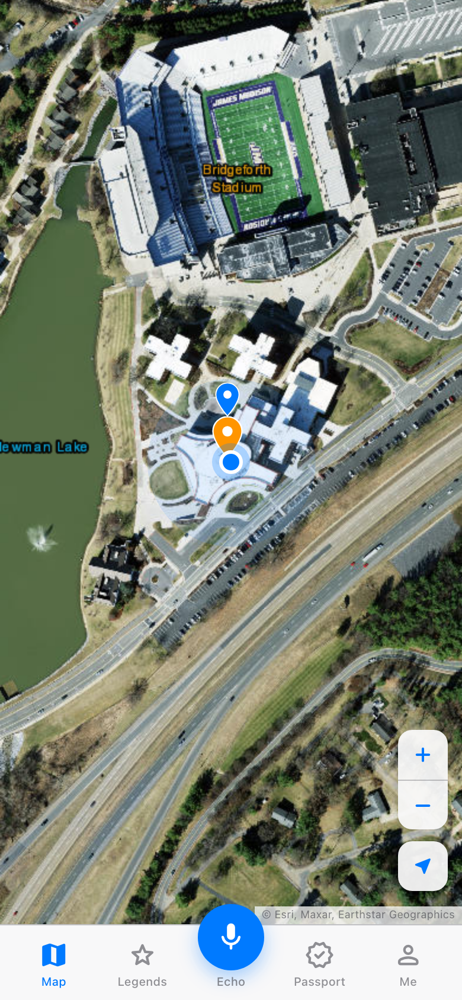
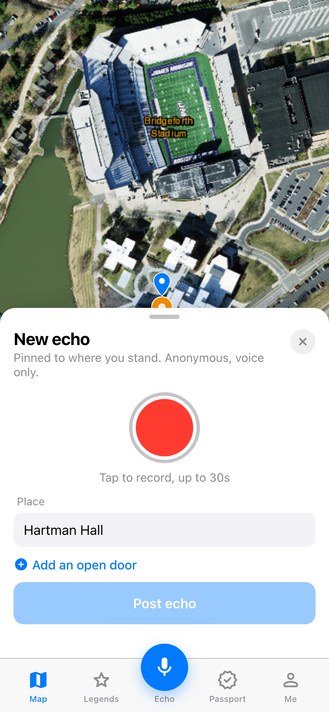
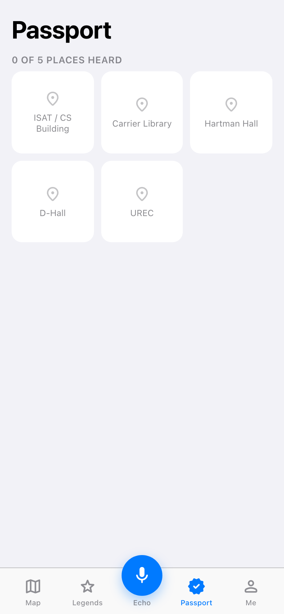

# Echoes

**Hear JMU by standing where it was said.**

Echoes is a haunted campus made of anonymous voice notes. Students leave short recordings pinned to real places on campus and around Harrisonburg, and you can only hear one by standing at the spot. Popular echoes become campus folklore, and some point to real clubs and events, so the app works as a way into communities that already exist.

We built it in 24 hours at the JMU Makeathon (November 13 to 14, 2026) and placed **third**. The prompt was "break out of your comfort zone." We showed a working phone demo, and everyone in the room could open it and use it at the same time.

  
  
  
  

The demo: map, record an echo, Legends, Passport. Legends shown here are seeded example echoes.

## The idea

Students stay in their dorms and miss what is happening around them. Clubs and events have a social barrier to entry. We did not want to promise anyone a best friend. Nobody can break someone else's comfort zone for them, so the app's job is to make the first step smaller and point somewhere real.

Our line in the pitch was **"You help us help you."** The student takes the step; Echoes makes it easier and shows where to take it.

It works in four small steps, each a little outside what a student would normally do:

1. **Go.** You visit places you would never stop at, because that is where the voice is.
2. **Hear.** You listen to people outside your circle and outside your major.
3. **Say.** You leave an echo yourself, anonymously, which is the lowest-risk way to speak up.
4. **Receive.** You get a reply, or hear an echo, that points to something real and nearby.

How it works:

- **Location-locked.** You can only hear or record an echo by being at its spot. Far-away echoes show as locked on purpose.
- **Legends.** Echoes that enough people relate to (25 likes in the demo) become Legends, with an auto-generated title like "The Carrier Stairwell Confession". Ranking rewards "me too" and not mockery.
- **Open doors.** An echo can carry an optional invitation to a real club or event. The voice stays anonymous, and the invitation points at something real.
- **Safety.** Voice only, transcripts screened before posting, no naming individuals, crisis-adjacent content kept out of Legends and given a support card.
- **Everything is opt-in.** No streak penalties, no guilt notifications, nothing arranged for you.

The full outline, including the research behind it and where we say plainly that the core mechanic already exists in other apps, is in [IDEA.md](IDEA.md).

## Why JMU would want it

From our pitch, using JMU's published numbers: about 4,900 first-years arrive each year, and 91.3% come back, against a goal of 94%. Getting students to show up to clubs and events is the goal, and Echoes is a way in. For money we kept it small: clubs, club leaders and student government could pay a small fee to promote a voice note, and campuses could fund it too.

## How it grows

1. **Start small.** Just JMU at first, through OPAs, FROGs, RAs and club leaders.
2. **Grow local.** Out into the wider Harrisonburg community, so more of campus life is on the map.
3. **Add campuses.** Move campus to campus. A much bigger project, and more money.

## What we built

The demo is a mobile-first web app: a Go backend with an in-memory store, and a Vite + React + TypeScript frontend with a satellite map. Posting runs the transcript through simple guardrails (naming a person blocks the echo, crisis words add a support card). The map opens at Hartman Hall, where the demo ran. Technical notes, the API and how to run it are in [docs/DEMO.md](docs/DEMO.md).

What is real and what is not: the map, location lock, recording, likes, Legends, Passport, replies and the screening rules work in the demo. The example echoes are seeded, nothing is persisted, and there is no sign-in. Decay, seasons and multi-campus onboarding are described in the idea outline but not built.

## Pitch

We had a short slot with most of it left for questions. The deck is [docs/pitch/echoes-pitch-deck.pdf](docs/pitch/echoes-pitch-deck.pdf).

  
  
  

## Team

Built in 24 hours at the JMU Makeathon, November 13 to 14, 2026.

| | |
|---|---|
| [Enzo Hins](https://github.com/SketchyRock) | Came up with the idea. Wrote the outline, ran research and pitch prep, helped with the presentation and with deciding what to build |
| [David Hilscher](https://github.com/davidhilscher) | Presentation and coordination across the whole project, plus planning what needed to be built |
| [Luke Bonnell](https://github.com/lukem570) | Built the demo: Go API, React client, map pin layout, deployment |
| [Curtis Linweaver](https://github.com/xxfishshadowxx) | Helped shape the idea and the presentation |

## License

MIT, see [LICENSE](LICENSE). Use it however you like.
